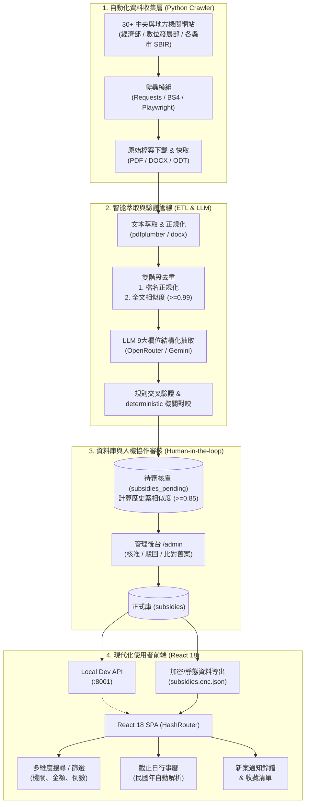

# 🔍 Palantir — 政府補助案情報情報站與智慧管線系統

> **全自動化政府補助情報中樞**：串接 30+ 中央與地方機關爬蟲，透過 LLM 與多階層去重演算法萃取非結構化公文，並搭配嚴謹的「待審核佇列（Human-in-the-loop）」與現代化 React 前端，為顧問與企業打造一站式補助案情報與截止日追蹤系統。

---

## 🌟 專案核心亮點 (Highlights)

- 🤖 **LLM 驅動的非結構化公文萃取**：自動解析 PDF/DOCX/ODT 須知文件，利用大型語言模型（LLM）精準抽取 9 大結構化欄位（資格、上限、自籌比、截止日、備審資料等），並搭配正則規則自動交叉比對驗證。
- 🔄 **雙階層智能去重與防呆機制**：檔名正規化結合「全文比對（SequenceMatcher 99% 門檻）」，並內建「申請類別守門器（TrackGuard）」，防止同計畫不同組別遭誤判合併。
- 🛡️ **安全第一的審核流水線 (Human-in-the-loop)**：爬蟲結果不直接覆蓋線上資料，先進入待審表（`subsidies_pending`）並智慧比對歷史相似案（相似度 ≥ 0.85）；由管理後台審核通過後才正式發布。
- 📅 **即時截止日行事曆與智慧篩選**：支援民國年/西元年自動容錯解析、各機關多選篩選、金額區間智能辨識，並提供月曆視圖直觀查看各日截止案。
- 🔒 **軍工級程式碼與資料防護**：
  - 前端管理審核代碼於 Production Build 透過 Dead Code Elimination (DCE) 徹底剔除，避免端點與業務邏輯外洩。
  - 正式站部署自動禁用 Source Map，靜態資料檔支援端對端加密（AES）。

---

## 🏗️ 系統架構圖 (Architecture)



---

## 🎯 核心功能導覽

### 1. 企管級補助案搜尋與即時篩選
- **機關分類**：自動依收錄筆數多寡即時排序 30+ 主辦機關。
- **金額動態級距**：正則解析「100萬元」、「3000萬」、「1億」、「依比例補助50%」等多元自由格式文字，自動歸納至標準區間。
- **動態期限倒數**：即時比對當日時間，標記「已截止」、「30天內」、「30-90天內」、「90天以上長期」及「未提供期限」。

### 2. 截止日行事曆 (Deadline Calendar)
- **智能日期引擎**：自動解析公文中各類非標準日期（如「113年10月15日」、「113/11/30 17:00」及「經費用罄為止」）。
- **聚合月曆檢視**：以月份為單位聚合截止專案，直觀呈現每日截止專案總數，點擊可直接彈窗檢視詳情。

### 3. 新案通知與追蹤鈴鐺
- **未讀徽章與推播選單**：即時計算最近一次審核通過之新案件，提示使用者第一手最新政府釋出補助。
- **我的收藏（Favorites）**：無縫本地儲存機制（LocalStorage 服務封裝），隨時追蹤重點標案。

### 4. 獨立管理審核台 (`/#/admin`)
- **雙重對比介面**：針對 `suspected_dup_of`（歷史相似度 ≥ 0.85）的補助案，提供左右並排對照介面，杜絕重複審核。
- **一鍵核准/駁回**：審核通過即同步正式庫；被退回的案子於日後管線執行時自動標記略過。

---

## 💡 工程挑戰與技術突破 (Key Engineering Challenges)

### 1. 非結構化政府公文轉結構化 JSON
- **挑戰**：各機關公告須知檔案格式繁雜（PDF、ODT、DOCX 混雜），甚至包含掃描檔或無文字層文件；日期多採用民國年、自由文字混雜。
- **解法**：建立統一的文字正規化抽取層，整合 `pdfplumber`、`python-docx` 與 `odfpy`；提示詞針對 9 大核心欄位（申請資格、金額上限、自籌款比例、截止日、備審清單等）嚴格制定 Schema，並以 Deterministic Rules 補足模型抽取的幻覺。

### 2. 雙重去重架構與分類衝突守門機制
- **挑戰**：相同補助案常伴隨多個格式（如 PDF + ODT 下載）或分段附件（如「附件1-3」、「附件4-6」），直接比對會造成資料重複或錯誤抽取碎片檔。此外，部分中央計畫於同份須知中分為「研發類」與「服務類」，不能單純以高相似度合併。
- **解法**：
  1. **第一階段（檔名去重）**：副檔名清理、格式標籤清除，優先保留 PDF，過濾非 1 開頭之附件片段。
  2. **第二階段（全文比對）**：同部門比對全文相似度（門檻 0.99）；導入 `TrackGuard` 機制，若標題命中組別衝突關鍵字則強制獨立保留，避免誤刪不同子計畫。

### 3. 企業級安全隔離與資訊洩漏防護
- **挑戰**：專案部署於 GitHub Pages 等靜態託管環境，既要展示前台搜尋器，又要保護管理台後台的 API 接口與審核邏輯不被逆向工程。
- **解法**：
  - **編譯期死代碼消除 (Dead Code Elimination)**：管理台組件使用 `process.env.NODE_ENV !== 'production' ? require(...) : null` 導入。在生產環境打包時，Terser/Webpack 會將整段管理邏輯徹底自 Bundle 移除。
  - **Source Map 禁用**：生產環境強制關閉 Source Map 輸出，避免任何內部註解或路徑暴露。
  - **本機 API 綁定保護**：開發管理 API 嚴格監聽 `127.0.0.1`，避免局域網未授權存取。

---

## 🛠️ 技術棧 (Tech Stack)

| 領域 | 技術 / 套件 | 說明 |
|---|---|---|
| **前端 (Frontend)** | React 18, React Router v6 (HashRouter) | 響應式 SPA、無伺服器部署相容 |
| **圖標與風格** | Lucide React, Custom CSS Design System | 卷宗封面風格、無三方肥大 UI 庫負擔 |
| **爬蟲與數據工程** | Python 3.10+, Requests, BeautifulSoup4, Playwright | 多機關網頁爬蟲、動態渲染支援 |
| **文檔解析與 LLM** | pdfplumber, python-docx, OpenRouter / Gemini API | 文本萃取、9 欄結構化 JSON 提煉 |
| **後端與資料庫** | Python FastAPI / HTTP Server, PostgreSQL 16, Docker | 本地開發 API、增量審核資料庫 |
| **排程與自動化** | Windows Task Scheduler, Batch Scripts | 定時全自動管線運作 |

---

## 📂 專案結構 (Directory Structure)

```
Palantir/
├── React/                      # 前端 React 應用
│   ├── public/                 # 靜態資源 (可含加密資料檔)
│   ├── src/
│   │   ├── components/         # 共用元件 (Navbar, SubsidyCard, PasswordGate, AdminLayout)
│   │   ├── pages/              # 頁面 (HomePage, SearchResults, Calendar, ReviewPage...)
│   │   ├── services/           # API 與 LocalStorage 服務層
│   │   └── utils/              # 輔助函式 (日期/民國年解析、金額格式化)
│   └── package.json
│
├── subsidy_crawler/            # 後端爬蟲、ETL 與 LLM 萃取管線
│   ├── sites/                  # 各中央與縣市機關爬蟲 Adapters (30+ 部會)
│   ├── common/                 # 共用工具 (文字萃取、LLM 調用、資料庫同步、去重守門)
│   ├── extract_fields.py       # 9 大欄位結構化抽取主腳本
│   ├── postprocess.py          # 後處理與去重
│   ├── pipeline.py             # 一鍵自動化端到端 ETL 管線
│   ├── dev_api.py              # 本機審核與資料查詢 REST API
│   └── requirements.txt
│
├── docker-compose.yml          # PostgreSQL 與本地環境容器編排
├── run_pipeline.bat            # 自動化排程執行腳本
├── .env.example                # 環境變數範例檔
└── README.md
```

---

## 🚀 快速上手 (Quick Start)

### 1. 環境需求
- Node.js (v18+)
- Python (3.10+)
- Docker & Docker Compose

### 2. 環境變數設定
複製設定檔範本並填入必要資訊：
```bash
cp .env.example .env
```

### 3. 啟動資料庫與後端服務
```bash
# 啟動 PostgreSQL
docker compose up -d postgres

# 安裝 Python 依賴
pip install -r subsidy_crawler/requirements.txt

# 啟動本機開發 API (監聽 127.0.0.1:8001)
python -m subsidy_crawler.dev_api
```

### 4. 啟動前端開發伺服器
```bash
cd React
npm install
npm start
```
開啟瀏覽器前往 `http://localhost:3000` 即可使用系統。若需進入管理審核台，請前往 `http://localhost:3000/#/admin`。

### 5. 執行完整爬蟲與萃取管線 (ETL Pipeline)
```bash
# 執行端到端管線 (爬蟲 → 萃取 → 去重 → 增量寫入待審庫)
python -m subsidy_crawler.pipeline

# 測試模式 (跳過資料庫寫入)
python -m subsidy_crawler.pipeline --skip-db
```

---

## 📄 License & Author

- **Author**: littlewhite890618
- 本專案採用 [MIT License](LICENSE) 開源授權。
